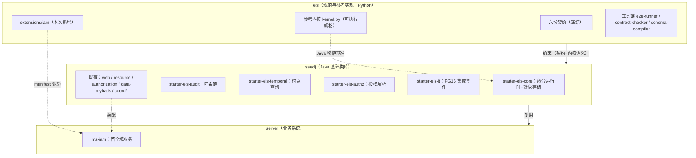
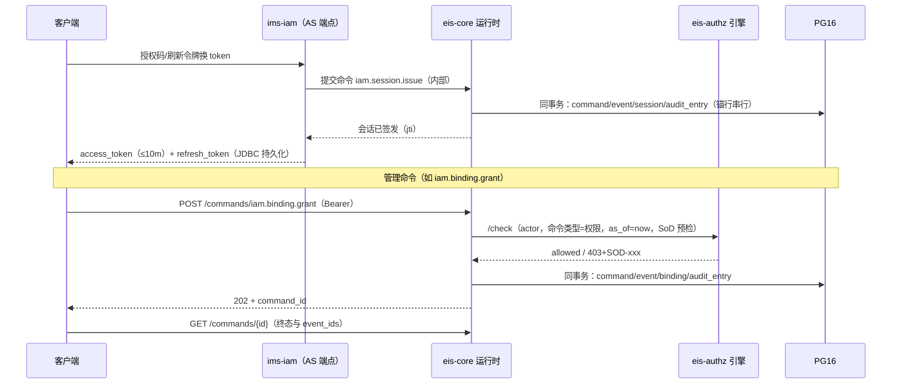

# IAM 首落地 · 落地方案（执行回执版）

> **校注（公开开源复核）**：本文记录的是 IAM 落地当时的执行结果与方案论证，**一切以 `eis`/`seedj`/`server` 各仓库当前代码为准**。独立评估发现的本仓库与实现差异包括：OAuth2 refresh 流程、读路径授权（read-authz）、outbox 在无消费者时的空分发语义等；文中「已落地 / 验收全绿」等表述仅代表落地时快照。另：历史计数与绝对路径为落地时记录，规范仓库当前计数以 `python3 tools/e2e-runner --all` 实际输出（134/134）为准。

> **v1.0.0（2026-10-10）执行完毕**：M0–M6 全量落地（M6 试点签署留组织动作），三仓验收全绿——`eis` e2e-runner **53/53 + 1/1 + 5/5**、`seedj` `./mvnw -B verify` **BUILD SUCCESS**（含 eis-it 21/21）、`server` `mvn -B -pl ims-iam verify` **15/15**（IAM 对照 10 + 授权服务器流程 5）+ `scripts/smoke-login.sh` **7/7 SMOKE OK**。逐项回执、coord 使用实证与实现偏差见 **§11 执行回报**；§8 决策点 #1–#16 全部按推荐执行。**本文档状态：已执行**（评审稿历史版本见下方向下行）。
> **版本**：v0.3（评审稿第三版，2026-10-09）——按「**能用 coord 即基于 coord**」要求，对 coord 的 **policy / workflow / mq / cache / transit / txn** 做逐服务**证据级再评估**：新增 §3.4.1–§3.4.5 深评、修订 §6.5 与 §8（#3/#4/#8/#11 修订，新增 #13–#16）、§9、§10.4；并同步上游 **v0.2.1** 事实（dev 全服务预设闭合，ADR-0009）；**同日补评：PKI 作为 IAM 的 KMS（§3.4.5 重写 / #16 定案）**
> **v0.3.1（2026-10-10 上游事实同步）**：coord **v0.2.2** 已全量落地 `docs/COORD-REQUIREMENTS.md` 的 15 条缺口（ADR-0010，accepted），`coord-java-sdk 0.2.1` 发布 Maven Central；本文事实性陈述按 v0.2.2 同步（相应处加「▸v0.2.2」标注）——**§3.4.1 再评估条件①（bundle 分发）已闭合**，**决策点表决清单不变**（#13 维持 T4′：其余三条件未满足）。回执与消费方实测见 `docs/COORD-REQUIREMENTS.md` §7。
> **范围**：`eis`（IAM 领域扩展与参考实现）→ `seedj`（EIS 通用能力）→ `server`（第一个 IAM 服务）
> **硬约束**：中间件仅允许 **PostgreSQL 16 + coord**；不引入任何其他中间件（Redis/MQ/网关缓存等）
> **状态**：**本文档即评估对象**（代码尚未开工）；评审意见回来后冻结为 v1.0，按 §7 里程碑执行。
> **基线实测**：`python3 tools/e2e-runner --all` → 用例 **53/53**、场景 1/1、流水线 5/5。

### v0.3.1 变更摘要（上游 v0.2.2 事实同步，2026-10-10）

1. **发布事实**：coord `v0.2.2`（`3fa9b31`，2026-10-10 发布；ADR-0010 全量承接 G-* 缺口，契约 v1.3.0：+6 RPC/+4 字段）+ `coord-java-sdk 0.2.1`（Maven Central）。
2. **事实同步**：§3.4 表行（policy/mq/workflow/transit/pki）与 §3.4.1–.5、§7 建议节奏注、§8 #11/#13/#15/#16、§9 #7/#8、§10.4 均已按 v0.2.2 更新；§3.4.1 条件①闭合、②③④未变。
3. **消费方验证**：关键验收测试本机实跑全过（清单见 `docs/COORD-REQUIREMENTS.md` §7.2）；IMS/seedj 侧后续（镜像升 v0.2.2、coord-it 交叉验证、X-1 试点回执）按你的指示推进、暂未执行。

### v0.3 变更摘要（二轮再评估：policy / workflow / mq / cache / transit / txn）

1. **§3.4 重写为逐服务证据版**：新增 **T4 指定**（唯一实现路径、分期落地）与 **T4′ 明确否决**（附再评估条件）两档；重点新增 **§3.4.1 策略引擎**（不接入判定路径——bundle 无启动加载/无跨 agent 同步、RBAC 仅 agent 本地、可用性耦合）、**§3.4.2 队列**（coord MQ 指定为跨服务事件通道；Poll+Ack、ISR 前提、v1 不接入）、**§3.4.3 事务**（业务事务全留 PG；coord Txn 不入业务路径；workflow 补偿执行器未交付）、**§3.4.4 缓存**（触发式「纯 best-effort L2」协议）、**§3.4.5 密钥**（生产 JWT 密钥指定 PKI-ES256 签发 + RotateCert 轮换；transit 包裹可选）。
2. **§8 修订与新增**：#3 修订（MQ 由「v1.1 候选评估」改为「**指定通道** + 落地条件」）；#4/#8 修订（补 MQ 复用口径 / 缓存触发条件化）；#11 修订（前提已闭合，改为「待执行」）；新增 **#13 策略引擎**、**#14 跨服务队列**、**#15 事务 / 工作流**、**#16 生产密钥管理**。
3. **§0 / §3.2 / §6.5 / §7 / §9 / §10 / 附录 A 同步**；dev 收敛前提已由上游 **v0.2.1（ADR-0009：dev 全服务预设 + dev KEK）**闭合——收敛从「待上游」改为「**待执行**」（改挂官方 dev 容器、镜像 v0.2.0→v0.2.1）。
4. **事实底座**：coord `v0.2.1`（HEAD `2c61f23`）上游证据复核（契约 STATUS / ADR-0001·0002·0009 / boundaries B-SE-6·B-WF·B-PL-3/4 / 实现锚点），逐条在 §3.4 标注。
5. **补评（2026-10-09）：PKI 作为 IAM 的 KMS**（§3.4.5 重写、#16 定案、§6.5/§9 同步）——能力面：幂等 get-or-create 签发（CAS 单份/重启同钥/跨 agent 同 CA）、`GetCertByCN` 取回含私钥、`ListCerts` 仅公钥多密钥 JWKS（kid=serial）、`RotateCert/RenewCert` 轮换；**边界澄清**：非远程签名（私钥交付调用方）、无 HSM、无吊销/CRL、ES256-only、能力级门禁（`pki:cert:read` 即取任意 CN 私钥）；采用形态：v1 文件（建议 ES256）→ 生产 PKI（CN 分用途 + 到期前轮换纪律 + 私钥保管二选一）。
6. **新增 `docs/COORD-REQUIREMENTS.md`（提给 coord team 的业务缺口需求）**：把 §3.4 复核发现的缺口整理为正式需求文档——15 条缺口（G-POL-1/2、G-MQ-1..4、G-PKI-1..3、G-WF-1、G-TR-1/2、G-X-1、G-EV-1、G-SC-1），含业务需求 / 证据锚点 / 验收口径 / 优先级；§10.4 的观察项升级为组织级依赖跟踪。

### v0.2 变更摘要（首轮评审：coord 利用度再评估）

1. **新增 §3.4「coord 能力再评估」**：对 coord 内建服务（17 项 + 核心代理 + auth）逐项给出「T1 已用 / T2 v1 建议新增 / T3 不用」结论、依据与失败行为口径。
2. **§8 决策点修订**：#3/#4 维持「coord 不作投递/广播承诺」，但引入 **Event 仅做 best-effort 失效/唤醒脉冲**；#8 由「纯进程内缓存」修订为「进程内 TTL + Event 失效（可选）」；新增 **#11 dev 基础设施收敛（容器化 dev 模式）**、**#12 后台任务协调（选主/锁/PG 分层）**。
3. **§6.5 修订（dev 基础设施）**：上游 coord 已交付容器化 dev 模式（PR #40 + ADR-0008：单命令、宿主端口仅 loopback、Raft 收敛 loopback）；现状差距=该模式不启用任何内建服务且 `dev` 无服务配置入口——收敛条件与路径见 §8 #11。
4. **§9 风险修订**：新增「coord 功能面生产门禁未闭合」及缓解（v1 只依赖 T1 + fail-open 的 T2）；dev 配方风险改述。

---

## 0. 摘要（一页速览）

**方案一句话**：以 `eis/extensions/iam` 定义 IAM 领域契约（对象 / 命令 / 规则 / 可执行用例）→ 在 seedj 沉淀 5 个 EIS 通用模块（命令运行时、审计链、时点查询、授权解析、集成套件）→ 在 server 落地首个服务 `ims-iam`（OAuth2 授权服务器 + 授权解析权威 + 身份管理域），全程只依赖 **PG 16 + coord**。

| 仓 | 交付物 | 验收口径（详见 §4.8 / §5.5 / §6.7） |
| --- | --- | --- |
| `eis` | `extensions/iam` 完整扩展 + 内核 IAM 支持 + 文档/ADR | `e2e-runner --all` 全绿（用例 53/53）；PG16 DDL 冒烟过 |
| `seedj` | `starter-eis-core` / `eis-audit` / `eis-temporal` / `eis-authz` / `eis-it` | `./mvnw verify` 绿（覆盖率门禁）+ 审计冻结向量逐位一致 + PG16 IT 绿 |
| `server` | `ims-iam`（Spring Boot 应用，PG+coord 接线、Flyway、登录签发、IAM 命令、`/resolve` `/check`、审计链） | `./mvnw verify` 绿 + 与 `iam.test.yaml` 的 10 条场景逐条对照 + 冒烟脚本全过 |

**评估要点速览**（完整版 §8，均附推荐项）：

| # | 决策点 | 推荐 |
| --- | --- | --- |
| 1 | IAM 扩展与核心 04 契约的边界 | 管理面（对象/命令/规则）全部落扩展；04 判定语义不动 |
| 2 | 认证失败/拒绝命令是否入审计链 | v1 按核心语义（受理才入链）；安全审计通道留 ADR 候选 |
| 3 | 事件传播 | v1 不做跨服务投递（PG outbox）；**coord Event 仅做 best-effort 失效/唤醒脉冲**；**coord MQ 指定为跨服务事件通道（首个消费者落地时启用，#14）** |
| 4 | 令牌吊销 | 短 TTL（10m）+ `/check` 实时判定；不做吊销广播（Event 脉冲仅为加速；未来推送式吊销复用 #14 的 MQ 通道） |
| 5 | seedj 模块拆分 | 4+1 个模块（分两期交付）；T2 能力经可选接线接入 |
| 6 | server 工程结构 | 单模块 `ims-iam` 起步；第二个域进入时再拆 |
| 7 | ID 生成 | 应用侧 UUIDv7；coord IdGen 不进核心链路 |
| 8 | 缓存 | 进程内短 TTL + **coord Event 失效（可选，fail-open）**；coord Cache 服务端不启用（触发条件与启用协议见 §3.4.4） |
| 9 | OAuth2 客户端注册 | v1 配置静态注册；DCR 列 v1.1 |
| 10 | 命名与迁移分区冻结 | `iam 1.0.0`、`iam_*` 表、Flyway V1xx/V2xx/V3xx |
| 11 | dev 基础设施 | 收敛到 coord **容器化 dev 模式**；前置已由 v0.2.1/v0.2.2（ADR-0009）闭合，收敛目标版本 v0.2.2，待执行（§8 #11） |
| 12 | 后台任务协调 | 分层：长驻单例→LeaderElection；短临界区→Lock；数据串行→PG（§8 #12） |
| 13 | 策略引擎 | **判定唯一权威 = eis-authz**；coord Policy 不接入判定路径（▸v0.2.2：分发缺口已补齐；可用性耦合 + 语义漂移理由未变，证据 §3.4.1） |
| 14 | 跨服务队列 | v1 维持 PG outbox；**coord MQ 为指定通道**（Poll+Ack、幂等键=event_id、ISR 前提，§3.4.2） |
| 15 | 事务 / 工作流 | 业务事务全留 PG；**coord Txn 不入业务路径**；workflow 不用于 v1（v1 无 saga 需求；▸v0.2.2 补偿执行器已提前交付，§3.4.3） |
| 16 | 生产密钥管理 | **PKI = IAM 非对称密钥 KMS**（ES256 幂等签发/取回/多密钥 JWKS/轮换；非远程签名、无 HSM/吊销）；v1 文件（建议同 ES256）；transit 包裹可选（§3.4.5） |

---

## 1. 目标与非目标

### 1.1 目标

1. **eis**：在 `extensions/iam/` 建立 IAM 领域扩展（按冻结的扩展结构），并让它的每条规则/命令**可执行、可验证**（对齐参考内核 `tools/lib/kernel.py` 语义）。
2. **seedj**：为 EIS 增加通用能力——把参考内核的四类能力做成 Java 构件（命令运行时、审计哈希链、双时间轴时点查询、as_of 授权解析），供所有后续域复用。
3. **server**：落地第一个 EIS 域服务 `ims-iam`：统一命令入口、as_of 查询、授权解析权威、OAuth2 登录签发，审计链合规（目标等级 **L3**，见 `eis/docs/CONFORMANCE.md`）。

### 1.2 非目标（v1 明确不做）

- MFA/多因子、SSO 联邦（SAML、外部 OIDC IdP 互操作）、动态客户端注册（DCR）；
- 前端、网关（由部署侧另立；IAM 提供 `/check` 供其调用）；
- 生产环境 coord 的 TLS+CCT 改造（是部署前置，单独排期；本机 dev 配方可用）；
- accounting/inventory/approval 等域的落地（IAM 是**第一个**，其余顺延，见 §7 M6 之后）。

---

## 2. 现状与基线

### 2.1 三仓现状（已实测/已核对）

| 仓 | 现状 | 关键事实 |
| --- | --- | --- |
| `eis` | 六份契约冻结 + 3 个示例扩展 + 完整 Python 工具链 | `e2e-runner --all` = 53/53 + 1/1 + 5/5；DDL 由 CI 在 PG16 冒烟；扩展结构冻结（manifest/objects/operations/rules/views/migrations/tests） |
| `seedj` | JDK 21 / Boot 4.1.1 / Security 7 / Jackson 3 / MyBatis-Plus 3.5 / coord-java-sdk 0.2.0；web、resource、authorization、data-mybatis、coord 族（17 个子客户端 Bean 已接线）齐备 | 质量门禁：common ≥80% / starter ≥70% 行覆盖率、SpotBugs、japicmp、零测试守卫；规范：禁 record、禁 Lombok、中文 Javadoc；工作树含历史未提交改动（**不动**） |
| `server` | **仅剩 `docker/`**（应用代码已删）：compose 提供 PG16 @5432、coord v0.2.0 @19527（gRPC）/19528（诊断）；**未 git init** | `docker/README.md` 明示：生产 coord 必须 TLS+CCT；本机 dev 免鉴权仅限开发；**coord dev 配方当前为自定义**（server+agent+loopback 转发器，见 §6.5）；上游收敛前提已达成（v0.2.1），待执行（§8 #11） |

### 2.2 本次路线调整（相对 `eis/docs/IMPLEMENTATION.md`）

- 原 P1–P4 是「seedj 内核 → ims-finance」顺序；本方案**重排为 IAM 先行**。
- 理由：身份与授权是一切域的前置；且 IAM 一次性覆盖 EIS 最难的三个语义面——**as_of 授权解析、审计哈希链、双时间轴**。IAM 落地即是对 EIS 内核能力的最强验收。
- 原路线中的 `starter-eis-*` 命名（IMPLEMENTATION.md §1）被采纳并具体化为 5 个模块（§5）。

### 2.3 直接复用的先例（已核对文件）

- 扩展写法与用例格式：`extensions/accounting/*`（含 `tests/accounting.test.yaml` 场景结构）。
- 命令语义基准：`tools/lib/kernel.py`（幂等指纹算法、202/400/409、审计=受理命令、`_update_object` 版本封口、`as_of` 半开区间）。
- 表结构基准：`01-data-contract/core.ddl`（`business_object` 模板、`event`、`command`、`view`，含 append-only 规则）、`05-audit-contract/audit.ddl`（`audit_entry`）。
- 安全闭环：`starter-authorization`（issuer、`SeedjJwtClaimsCustomizer` 签发 `userId/tenantId/preferred_username/authorities`）+ `starter-resource`（默认链、`SeedjJwtAuthenticationConverter` 消费），闭环已被 seedj 测试与上一代 IMS 实测验证。
- coord 能力面：17 个内建服务（registry / config / lock / leader-election / idgen / event / cache / mq / workflow / scheduler / policy / featureflags / circuitbreaker / ratelimiter / transit / pki / replication）+ 核心代理（KV/Txn/Watch/Lease）；seedj `starter-coord` 全家（客户端 Bean / 注册 / 配置 / LB）已落地，`coord-it` 14 类 33 例在真实 coord 上验证（含 cache/mq/workflow/transit 等本方案 v1 不启用的面）；
- coord **容器化 dev 模式 + dev 全服务预设**（v0.3 更新）：ADR-0008（容器化）+ **ADR-0009（`ServiceConfig::dev_mode()`：除 `replication` 外 16 个内建服务全开 + dev 专用默认 KEK）**，已随 **v0.2.1** 发布（ghcr `v0.2.1` / `sha-2c61f23`）；本机已实测 v0.2.1 dev 容器（插件注册 17 条、healthz 200、宿主端口仅 loopback、Config/Lock/Transit 真实调用通过）——§8 #11 收敛前提闭合（§6.5）。

---

## 3. 总体架构与中间件约束

### 3.1 三层关系



### 3.2 中间件矩阵（硬约束的落点，逐项）

| 基础能力 | v1 落点 | 说明 |
| --- | --- | --- |
| 持久化 | **PG 16** | 唯一数据权威；Flyway 管迁移；DDL 来自契约生成物 |
| 幂等/并发 | **PG 约束**（唯一键/部分唯一索引/行锁） | 正确性不依赖分布式协调 |
| 分布式锁 | **coord** `CoordLockService` + **LeaderElection**（T2） | **仅任务级**：短临界区=锁（引导、迁移互斥）；长驻单例任务=选主（锚定导出、清理；§8 #12）；不进命令请求链路 |
| ID 生成 | 应用侧 **UUIDv7**（eis-core） | 时间有序、离线可用；coord IdGen 不进核心链路（评估点 7） |
| 配置 | **coord** 配置中心（`ims` / `ims.iam` 前缀） | `@ConfigurationProperties` 级运行期刷新 |
| 注册/发现 | **coord** registry | `service-name=ims-iam`；调用方消费走 coord-client LB |
| 事件/消息 | **PG outbox**（事务内写入 + 应用内分发）+ **coord Event 失效/唤醒脉冲**（T2，可选）+ **coord MQ**（T4 指定：跨服务通道，首个消费者落地时启用） | v1 不承诺跨服务投递；Event 仅做同域多实例失效/唤醒（默认不补投；▸v0.2.2 起显式游标可在保留窗口内补投——仍 fail-open）；MQ 口径 = Poll+Ack、幂等键 = event_id（§3.4.2、评估点 14） |
| 缓存 | **进程内短 TTL + coord Event 失效**（T2，可选） | v1 不启用 coord Cache 服务端（跨节点提交原子性边界，coord ADR-0002）；若启用按 §3.4.4 的「纯 best-effort L2」协议（评估点 8） |
| 限流 | **coord** RateLimiter（粗） + **PG** 失败计数（准） | 登录防爆破的跨实例正确性由 PG 保证；coord 只做第一道闸 |
| 加密/密钥 | 应用侧散列（bcrypt/argon2）+ JWT 签名密钥文件（v1，建议 ES256） | coord Transit/PKI 不做 v1；**生产：PKI = IAM 非对称密钥 KMS**（ES256 签发/取回/JWKS/轮换；transit 包裹可选，§3.4.5、#16） |
| 观测 | coord observability + Actuator | 健康检查探 coord Agent（参考 docker/README 配方） |

### 3.3 五条设计原则

1. **契约唯一权威**：文档、语义、验收一律以 eis 仓库为准；Java 实现与 `kernel.py` 逐语义对齐。
2. **PG 为一致性权威**：锁只做内务；任何「靠锁保证正确性」的方案一律否决。
3. **写路径全命令化**：幂等 + 规则 + 事件 + 审计 + 版本封口一个不能少；读路径全 `as_of` 化。
4. **中间件白名单是硬约束**：任何新依赖（含「只是个库」的缓存/调度）需过评审。
5. **一切验收可执行**：每条规则、每个命令都有可跑的用例（eis 侧 YAML 场景 + server 侧对照测试）。

### 3.4 coord 能力再评估（v0.3 证据版：能用即用，逐项到证据）

**评估口径（本轮修订）**：以「**能用 coord 即基于 coord**」为默认取向，同时过三道闸——① **语义可承载**（coord 的承诺与边界足以承载 IAM 所需语义，且不把业务期望写进协调面）；② **正确性不外包**（数据权威 / 判定权威 / 审计留在 PG + EIS 契约内；coord 只做协调，失败可降级）；③ **采纳即定义**（给接线形态、失败行为与再评估触发条件，不做「先接上再说」）。

**结论分档**：**T1 已用**（v1 承诺）｜**T2 v1 新增**（best-effort，fail-open）｜**T3 不用（v1）**｜**T4 指定**（本方案唯一实现路径，按触发条件分期落地）｜**T4′ 明确否决**（附再评估条件，全部满足才重开议题）。

| coord 能力 | v0.2.1 事实与边界（证据锚点） | v0.3 结论 |
| --- | --- | --- |
| registry / config / lock / ratelimiter / observability | seedj 落地 + `coord-it` 实证（沿用 v0.2 证据）；ratelimiter 为 agent 本地态 | **T1**（不变，见 §6.5） |
| leader election | Lease+Watch+Txn 选主；契约目标 2026-11-30 | **T2**（不变）：长驻单例任务（§8 #12） |
| event | 连接存续期 at-least-once；**▸v0.2.2：持久化游标已落地（G-EV-1）——默认实时不补投；显式携带 cursor 时在保留窗口内按 seq 补投（重放与实时之间不丢、可能重复，消费需幂等）** | **T2**（不变）：失效/唤醒脉冲，fail-open（可选升级：持久化 seq 作补投游标） |
| **mq** | **唯一 at-least-once 路径 = Poll+Ack**（Subscribe 为 best-effort、背压即丢）；幂等键与消息同事务去重（重启仍去重）；**per-agent 本地存储**，跨 agent 投递需启用 `replication`（ISR；subscribe/ack 仅分区 Leader）；容量 1GB/agent、逐写严格拒绝 `RESOURCE_EXHAUSTED`（B-PL-4）；**▸v0.2.2：`GetTopicLeader` + NOT_LEADER/`coord-leader-hint` 路由、公开 `MoveToDlq`、`DeleteTopic` 全量回收、消费组 lag 指标已开放（G-MQ-1..4；SDK 0.2.1 含路由/提示 API）** | **T4 指定（跨服务事件通道）**：首个跨服务消费者出现时启用；形态 = outbox relay → `Publish(idempotency_key=event_id)` → 消费方 **Poll+Ack**（§3.4.2；毒消息处置 = 显式 `MoveToDlq`，自动投毒判定仍不承诺）；v1 不接入（无消费者，避免空转依赖） |
| **cache** | 单节点原子 / **跨节点提交非原子**（ADR-0002：错误 ≠ 未写入）；静态分区 Leader、失联分区不可写、无自动故障转移；1GB 周期上界（B-PL-3）；无 INCR、无跨键事务、无线性一致读 | **T3（条件候选）**：v1 不用；触发条件与「纯 best-effort L2」协议见 §3.4.4 |
| **policy** | OPA（Regorus）本地求值 + `Explain` trace；bundle 存 Server KV；**▸v0.2.2：分发已落地（G-POL-1）——启动全量加载 + Watch 收敛（≤10s 量级）+ per-key CAS 版本单调（消费方实测通过）**；RBAC 策略仍为 **agent 本地内存**（G-POL-2 定谳：不提供管理面，生产走 bundle）；目标 2026-12-31；生产默认关（ADR-0001） | **T4′ 明确否决（不接入判定路径；条件①已闭合、余三未满足，维持）**：判定唯一权威 = eis-authz；四条理由 + 四条件再评估见 §3.4.1 |
| **workflow** | **▸v0.2.2：补偿执行器已提前交付**（`sw` 编译器 `compensatedBy` + 三步逆序补偿 e2e，用例另暴露并修掉两处静默丢副作用缺陷）+ 保留策略（`DeleteInstance`/`DeleteDefinition`，终态/引用守卫）；目标 2027-03-31（主体已提前落地） | **T3**：IAM v1 无 saga 需求；跨域长流程立项时再评估（前置「补偿执行器交付 + 端到端验收」**已闭合**，§3.4.3） |
| **txn（底座）** | CAS 原子事务（STABLE）；**已提交不可回滚**（业务补偿自负）；`request_id` 幂等仅单节点/60s/不复制；已是 coord 内部原语（锁/选举/CAS/bundle 版本） | **T3（不入业务路径）**：业务事务 = 单 PG 事务；coord Txn 仅 coord 内部使用（§3.4.3） |
| **transit** | 信封加密（AES-256-GCM）+ HMAC 签验（**无非对称签名**——不能代签 JWT）；DEK packet 落 server KV（重启不丢 / 跨 agent 共享 / 单次使用）；KEK 外部注入 fail-closed；**▸v0.2.2：KEK 多材料解密窗口 + `Rewrap` 已落地（G-TR-1；B-SE-6 更新为「迁移完成前不得下线旧材料」）**；明确「不是外部 KMS」 | **T4 指定（生产密钥静态包裹，可选）**：JWT 私钥静态加密存储的候选加固；v1 不接入（§3.4.5） |
| **pki** | **ECDSA P-256（= ES256）**，KeyUsage/EKU 兼顾签名与 TLS；`IssueCert` **幂等 get-or-create**（Txn CAS 单份、重启同钥、跨 agent 同 CA）、单 active + retired 历史；`GetCertByCN` 取回**含私钥**、`ListCerts` 仅公钥多密钥 JWKS（kid=serial）；`RotateCert`/`RenewCert` 轮换；KV+Barrier 存储；能力门禁 `pki:cert:{read,issue,rotate}`——**read 可取任意 CN 私钥**（无按 CN 隔离）；**无吊销/CRL、非远程签名**；**▸v0.2.2：到期 = 换新触发（Issue/Rotate 对过期记录版本化 CAS 重签）+ 到期观测指标（G-PKI-1/2）**；到期前轮换仍为运维纪律 | **T4 指定（IAM 的 KMS：非对称密钥生命周期）**：生产=PKI 承担签发/取回/多密钥 JWKS/轮换（§3.4.5 补评）；v1 维持文件密钥（建议 ES256） |
| idgen / scheduler / featureflags / circuitbreaker / replication / auth-CCT | 沿用 v0.2 口径（idgen 非 UUIDv7；scheduler 2027-03；featureflags 与配置键重叠；CCT 为生产前置）；`replication` 是「MQ/缓存跨 agent」的**前提服务** | **T3**（不变；scheduler/featureflags 维持 v1.1 观察口径）；`replication` 仅当采用 §3.4.2 时按需启用 |
| 核心代理（KV/Txn/Watch/Lease） | STABLE；agent 读缓存默认关 | **T3**：EIS 状态一律 PG，不经 coord KV |

> **两条总原则（不变）**：**① 契约边界不扩写**——coord 的「agent 本地态」「事件默认不补投（▸v0.2.2 起显式游标可在保留窗口内补投）」「Poll+Ack 才 at-least-once」「跨节点提交非原子」等语义不因业务期望而改变；**② 失效不失败**——T2 全部 fail-open（Event 丢失 → TTL/轮询兜底；选主不可用 → 任务延后）。
> **接线原则（v0.3 更新）**：T1/T2/T4 一律直用 seedj `starter-coord` **已装配的 17 个客户端 Bean**（含 `PolicyClient`/`MqClient`/`CacheClient`/`TransitClient`/`WorkflowClient` 等；`coord-it` 已对 mq/cache/transit/workflow 基础面实测），不等待 coord 家族 Phase 4 声明式封装；EIS 侧只加最小胶水（失效订阅器 / 选主基座 / relay），全部 kill-switch。

#### 3.4.1 策略引擎：coord policy 是否承载 IAM 判定（T4′ 详述）

**coord policy 能力面（v0.2.1，证据）**：

- 评估入口两类：`CheckPermission`（RBAC，**agent 本地内存**，仅进程内可装载、契约无管理 RPC）与 `Evaluate`/`Explain`（Regorus 本地求值，可跑任意 Rego）；
- Rego bundle：存 coord-server KV（版本化 / CAS / rollback）；**▸v0.2.2：分发已落地（G-POL-1）**——agent 启动从 KV 全量加载 enabled bundle + Watch 收敛（≤10s 量级）+ per-key CAS 版本单调（证据：`coord-agent/src/services/policy.rs` 的 `load_all_bundles`/`run_bundle_watch`；判据 `coord/tests/policy_bundle_distribution_test.rs`，消费方 2026-10-10 实测通过）；
- 生产口径：默认关（ADR-0001），目标 2026-12-31（`apis/contracts/STATUS.md`）。

**IAM 判定需求（04 契约）**：`/resolve` `/check` 的判定依赖 ① `as_of` 双时间轴重建（数据在 PG，须先由 Java 侧查询）；② 代理展开、绑定作用域、SoD（prevent/warn 与 `reason_code`）等契约化语义；③ 确定性 + 可离线验证（kernel 向量、e2e-runner 对照）；④ 网关高频调用下的可用性与延迟；⑤ 多实例一致性（同一请求在任一实例必须同判）。

**判定：不接入（T4′）**。四条理由（按重要性）：

1. **多实例一致性缺口（▸v0.2.2 已闭合）**：原证据「bundle 仅装配于单 agent、重启即失」已被 G-POL-1 分发补齐（启动加载 + Watch 收敛 + 版本单调）；该条自 v0.2.2 起不再构成否决理由；
2. **可用性耦合**：判定是请求链路核心；coord policy 为 COMMITTED（未生产验收，ADR-0001 默认关）——把判定依赖它等于把 IAM 可用性绑在未验收能力上；若为其设计「本地 Java 兜底」则回到双实现（见理由 4）；
3. **语义分叉面大**：`as_of` 重建与代理展开留在 Java、SoD/`reason_code` 由契约定义——可外包的只剩「纯函数段」；同时 `iam` 规则/SoD 将出现「eis YAML + kernel + Java + Rego」四份表达，契约唯一权威与「每条规则可执行验证」纪律被稀释；
4. **价值薄**：Java 侧已完成难的部分（时间轴、代理、缓存失效），coord 只承接末端判定——换不来正确性，只换来依赖与漂移面。

**已评估的中间变体（一并否决）**：变体 B「bundle 存 coord KV + JVM 内嵌 Rego 求值」——须引入白名单外的 JVM Rego 引擎，语义双表达与 `as_of` 留在 Java 的问题不变，无增量价值；变体 C「coord policy 仅作构建期/评审期实验工具」——非产品链路，无需采纳（保留为人工评估手段即可）。

**再评估触发（四条全部满足才重开，缺一不议）**：

1. 上游补齐 **bundle 分发**（启动自 KV 加载 + 跨 agent Watch 同步 + 一致版本语义）并有验收测试；
2. coord 生产门禁闭合（TLS/CCT + 该服务生产验收），修复 §9 #11 约束；
3. 存在 **「契约 → Rego」的生成与验证路径**（构建期生成 bundle + e2e-runner 可执行 Rego 对照向量），杜绝手工双维护；
4. 给出判定路径的可用性方案（coord 不可用时的明确降级行为；若降级 = 本地引擎，需先论证双实现运维成本可接受）。

> **▸v0.2.2 同步（2026-10-10）**：条件 **① 已闭合**（分发/启动加载/收敛 + 验收测试，见上）；② 生产门禁仍待 coord 生产化（未变）；③「契约→Rego」生成与验证路径 = 消费方提供项（我方，未启动）；④ 可用性方案 = 方案项（未启动）。**四条全满足或另行表决前，T4′ 与「判定引擎唯一」结论维持。**

> 组合结论：**判定引擎唯一 = `starter-eis-authz`**（语义与向量验收在 M3）；coord policy 的 `Evaluate/Explain` 仅保留为**评审期工具面**候选，不进产品链路。

#### 3.4.2 队列：coord MQ 承接跨服务事件与 outbox relay（T4 指定）

**coord MQ 能力事实（v0.2.1）**：`Publish`（幂等键与消息同事务去重；承诺「已持久化到本 agent」；ISR 进度不在响应内）→ **`Poll`+`Ack` 是唯一 at-least-once 路径**（Ack 前崩溃 = 重复投递；游标重启续传）；`Subscribe` 为推送 best-effort（背压即丢，不可用于正确性路径）；**▸v0.2.2：DLQ 增公开 `MoveToDlq`（净额记账）与 `dlq_reason/detail` 字段（G-MQ-2）**；**per-agent 本地存储**——跨 agent 投递须启用 `replication`（ISR）并按分区 Leader 路由（**▸v0.2.2：`GetTopicLeader` 查询 + 非 Leader 结构化错误 `NOT_LEADER`/`coord-leader-hint`，SDK 0.2.1 已含重路由 API；G-MQ-1**）；容量 1GB/agent 且逐写严格拒绝（超界 `RESOURCE_EXHAUSTED`），按 topic `retention_secs` 回收（**▸v0.2.2：`DeleteTopic` 全量回收 + 消费组 lag 指标，G-MQ-3/4**）。

**IAM 需求与判定**：

- v1（单服务、无消费者）：**不接入**——引入 MQ 没有接收方，只会产生空转依赖与配置面；PG outbox 的「同事务写入 + 可重放」已达成 v1 所需全部语义（§8 #3）；
- v1.1+（首个跨服务消费者出现，如 ims-finance 订阅 IAM 域事件）：**指定 coord MQ 为唯一跨服务通道**（不再另做选型）。冻结形态：
  - **生产侧（IAM）**：outbox relay worker（多实例用 PG `SKIP LOCKED` 领取，§8 #12）→ `Publish(topic=ims.iam.events, partition=hash(aggregate_id), idempotency_key=event_id)` → 标记 dispatched；relay 失败退避重放——**outbox 是真相源，MQ 是传输**；
  - **消费侧**：各自 consumer group，**Poll+Ack** 循环（禁用 Subscribe 承接正确性）；以 `event_id` 去重（MQ 幂等键 + 消费侧业务幂等双保险）；
  - **失败口径**：容量满（`RESOURCE_EXHAUSTED`）→ relay 背压（outbox 不丢）；重复投递 → 消费幂等吸收；毒消息处置 = 消费者显式 `MoveToDlq`（▸v0.2.2 已开放；自动投毒判定仍不在 coord 承诺内）；
  - **部署前提**：跨实例/跨服务投递时启用 `replication` 并核对分区 Leader 路由（单 agent 拓扑无此前提；▸v0.2.2：路由查询 + SDK 支持已交付）；
- **不做**「投递即承诺」的吊销广播（#4 维持）：令牌吊销仍靠短 TTL + `/check` 实时判定；若未来业务需要推送式吊销，通道也复用本节 MQ（而非 Event）；
- 内部任务分发**不走 MQ**：单写者周期任务用选主（#12）、批处理用 PG `SKIP LOCKED`——MQ 的消费组/offset/DLQ 机器对内部任务无增量语义。

#### 3.4.3 事务与工作流：为什么 coord 不应进入 IAM 业务事务（T3 详述）

- **coord.txn（STABLE）**：KV CAS 原子事务，**无实时回滚**、`request_id` 幂等仅单节点 60s；它是 coord 内部原语（锁/选举/配置 CAS/bundle 版本/工作流存储都在用），不是业务数据库事务。**EIS 业务事务 = 单 PG 事务**（command/event/对象/审计链一次提交）——引入 coord Txn 只会制造第二存储与双写一致性话题，无收益，明确不引入；
- **coord.workflow**：**▸v0.2.2：补偿执行器已提前交付**——`sw` 编译器支持 `compensatedBy` 补偿转场，三步逆序补偿端到端用例通过（该用例另暴露并修复两处静默丢副作用缺陷），并新增保留策略（`DeleteInstance`/`DeleteDefinition`）+ 语义文档；「补偿执行器交付 + 端到端验收」**已闭合**（早于 2027-03-31 目标）。IAM v1 的命令模型（单事务 + 审计 + 幂等）不构成 saga 需求；**跨域长流程**（如入转离多域联动）立项时再评估（余下前置 = 生产门禁闭合）；
- **跨系统一致性**：仍由 **PG outbox（§3.4.2）** 承担；coord 不提供、本方案也不寻求「PG ↔ MQ」的分布式事务。

#### 3.4.4 缓存：coord Cache 的启用协议（T3 条件候选）

**事实边界**：单节点原子、跨节点提交非原子（ADR-0002）；静态分区 Leader 失联 = 分区不可写（fail-closed，无自动转移）；落后副本最终一致；1GB 周期上界（B-PL-3）；无 INCR、无跨键事务、无跨 agent 线性一致读。

**v1 判定：不用**。进程内 TTL + Event 失效已把多实例失效窗口收敛到近实时；「共享 L2」不提供更强正确性，只新增失败模式（写错误 ≠ 未写、分区不可写、容量回收）。

**若启用（触发条件）**：多实例下授权解析热集重复计算被实测证明为瓶颈（成本/延迟指标），或明确需要跨实例共享解析产物。**启用协议（一旦触发，按此执行）**：

1. 只作 **L2 读缓存**，错误一律按 miss 处理（读失败回源 PG；写失败可忽略）——绝不参与正确性；
2. TTL ≤ 进程内 L1 TTL；失效仍走 Event 脉冲 + TTL 兜底；
3. **禁止**：用作计数/限流（无 INCR、非原子——准确层维持 PG）、OAuth2 授权状态、幂等键判定、任何「读不到即拒绝」的语义；
4. 容量按 B-PL-3 核算（默认 1GB、周期淘汰）并接受分区 Leader 故障时的暂时不可写。

#### 3.4.5 密钥：PKI 作为 IAM 的 KMS（补评）+ transit 包裹（T4 指定）

**「PKI 作为 KMS」能力面（v0.2.1，证据：`pki.rs` / `pki_store.rs` / `agent_pki_test.rs`）**：

- **签发**：`IssueCert(CN, ttl)` = get-or-create **幂等**——未过期则返回既有密钥；并发首签经 Txn CAS 保证单份；重启后取回同一私钥（有专测）；密钥固定 **ECDSA P-256（ES256）**，KeyUsage=DigitalSignature+KeyEncipherment、EKU=ClientAuth+ServerAuth（同一把钥匙可服务 JWT 签名与 TLS 场景）；TTL 默认 24h、可按需显式指定；
- **保管**：CA 与全部证书（**含私钥**）落 coord-server KV（redb + Barrier 加密），跨 agent 共享同一 CA（跨 agent 验签一致性有专测）；
- **取回**：`GetCertByCN` 返回当前有效证书**含私钥**（「供持有方恢复签名能力」；无/过期时返回 `NOT_FOUND`）；`ListCerts` 返回「active + 未过期 retired」且**仅公钥**摘要（kid=serial，供验签方构建多密钥 JWKS）；
- **轮换**：`RotateCert`（新 active、旧 retired 保留至 not_after）/ `RenewCert(serial)`；**无吊销/CRL、无删除**；**▸v0.2.2：到期 = 换新触发**——`IssueCert`/`RotateCert` 对过期记录走版本化 CAS 重签（新 serial/新密钥），`RenewCert(serial)` 保留为按序列号恢复入口（G-PKI-1）；到期观测指标 `coord_agent_pki_certs_expiring_soon`（窗口 `expiry_warn_hours` 默认 6h）+ 告警已开放（G-PKI-2）；到期前轮换仍是运维纪律；
- **授权**：能力级门禁 `pki:ca:init` / `pki:cert:issue` / `pki:cert:rotate` / `pki:cert:read`——**`read` 即可取回任意 CN 当前私钥**（当前契约未见按 CN/租户隔离；权限评审应按「私钥读取权」定级）。

**定位澄清（「KMS」能与不能，冻结为口径）**：

| 典型 KMS 期望 | coord PKI | 说明 |
| --- | --- | --- |
| 非对称密钥生成/托管/轮换 | ✅ | ES256 单算法；CA 跨 agent 共享 |
| 多密钥验签供给（JWKS） | ✅ | active + retired（未过期）公钥集 |
| 远程签名（私钥不出域） | ❌ | 无私钥驻留服务侧的 Sign API——**私钥以 `key_pem` 交付调用方**，签名在应用侧 |
| HSM / 硬件根信任 | ❌ | 存储 = server KV + Barrier 加密；主机被控 ⇒ 密钥泄露（与 transit KEK 同级信任模型） |
| 吊销 / 作废 | ❌ | 无 CRL/OCSP/删除；泄露响应 = CN 轮换 + 应用层处置（口径与 playbook 已落档：`security.md` §3 / `runbook` §4.5，G-PKI-3；CRL/OCSP 不在本轮） |
| 对称密钥/数据加解密 | ❌ | 属 transit（信封加密）；PKI 只做非对称身份/签名材料 |
| 按 CN/租户隔离 | ❌（当前契约） | 能力级门禁；权限定级时按「私钥读取权」对待 |

**IAM 密钥需求 × 覆盖结论**：JWT/ID token 签名密钥 ✅（本补评的 T4 指定）；JWKS 验签面 ✅；OAuth2 客户端密钥 ❌ 不需要（bcrypt 散列在 PG）；refresh token/授权码 ❌ 不需要（PG 内散列/不透明存储）；**数据静态加密**（若未来合规要求）→ 属 transit（非 PKI）；**审计链锚点签名**（若 evolve 出）→ 可复用 PKI 密钥 + 应用侧 ES256，列后续项、不在 v1。

**采用形态（冻结）**：

- **v1（dev/CI）**：维持文件密钥；**建议同为 ES256/P-256 JWK**——生产切换仅是「密钥来源：文件 → PKI」，JWT 算法/kid/验签面不变；
- **生产硬化（随 coord 生产化同批）**：CN 分用途（如 `ims-iam-jwt-signing`；未来 TLS/客户端证书各自立 CN）：
  1. **启动取键**：`IssueCert(CN, ttl≈90d)`（幂等可重试）→ 校验 `not_after > now`（▸v0.2.2：对过期记录 Issue 直接换新，G-PKI-1；异常时 `RenewCert(serial)` 兜底）；私钥仅内存持有（**不落盘**）；
  2. **JWKS**：`ListCerts` 公钥集（kid=serial）+ 应用侧运行期刷新（轮换窗口）；
  3. **轮换**：到期前 `RotateCert`（双 key 发布窗口）；**监控 `not_after`，到期前轮换为硬纪律**；
  4. **私钥保管二选一**：**(a) 不落盘**（每实例启动取回，启动依赖 coord——与 config 同级）；**(b) 落盘密文**（transit 包裹 `Encrypt(key_pem, context="ims-iam/jwt/v1")`，启用依赖 transit + KEK 材料运维）；
- **transit（对称面；可选加固）**：信封加密（AES-256-GCM）+ HMAC 签验（**无不对称签名**，不能代签 JWT）；DEK 落 server KV（重启不丢、单次使用、多 agent 共享 key 空间）；KEK 外部注入 fail-closed；**▸v0.2.2：多材料解密窗口 + `Rewrap` 已落地（G-TR-1；B-SE-6 更新为「迁移完成前不得下线旧材料」，流程 runbook §4.4）**，且明确「不是外部 KMS」——用途限私钥静态包裹等对称加解密；
- **明确不做**：把签名动作外包给 coord（PKI 无远程签名、transit 无不对称签名）；v1 不引入任何新增依赖（除既有 config/registry 语义）。

**风险/边界留档**：无远程签名与 HSM ⇒ 对外不得表述为「密钥不出主机」；泄露响应依赖 CN 切换 + 应用层；`pki:cert:read` 权限 = 私钥读取权，权限评审（#16 / §9 #8）按此执行。

---

## 4. EIS 侧：`extensions/iam`（领域扩展）

### 4.1 定位与边界（与核心 04 契约的分工）

| 面 | 归属 | 内容 |
| --- | --- | --- |
| 判定语义 | **核心 04（不动）** | principal/role/binding/proxy 元结构、`/resolve` `/check` API、SoD 规则与语义 |
| 管理面 | **iam 扩展（新增）** | 身份与授权关系的**生命周期**：对象、命令、规则、DDL 生成物、可执行用例 |

- 命名空间：命令 `iam.*`、事件 `iam.*.*`、错误码 **`IAM-`**（扩展自留；不占用核心 `EIS-`）。
- 扩展**不改核心**：对象一律 `allOf` 追加（引用 `01-data-contract/object.schema.json`）；Role/RoleBinding 为**管理面镜像对象**（字段语义与 04 对齐，补齐核心元字段，使其可生成 DDL、可被用例断言）——此为**评估点 1**。
- 扩展版本：`iam 1.0.0`，`core_version: 1.0.0`；`dependencies: []`、`conflicts: []`。

### 4.2 文件树（新增）

```
eis/extensions/iam/
├── README.md                        # 域说明（对标 accounting/README.md 写法）
├── manifest.yaml                    # 扩展清单（冻结结构）
├── objects/
│   ├── user-account.schema.json     # 用户账户
│   ├── credential.schema.json       # 凭证（密码散列，write-only）
│   ├── role.schema.json             # 角色（管理面镜像，语义对齐 04）
│   ├── role-binding.schema.json     # 授权绑定（管理面镜像，语义对齐 04）
│   └── auth-session.schema.json     # 会话（与令牌签发关联）
├── operations/                      # 每个命令一个 OpenAPI 文件（对齐 accounting 惯例）
│   ├── user-create.openapi.yaml     # iam.user.create
│   ├── user-update.openapi.yaml     # iam.user.update
│   ├── user-disable.openapi.yaml    # iam.user.disable
│   ├── user-enable.openapi.yaml     # iam.user.enable
│   ├── credential-rotate.openapi.yaml  # iam.credential.rotate（本人改密）
│   ├── credential-reset.openapi.yaml   # iam.credential.reset（管理员重置）
│   ├── role-define.openapi.yaml     # iam.role.define（定义/更新角色）
│   ├── binding-grant.openapi.yaml   # iam.binding.grant（含 SoD 预检）
│   ├── binding-revoke.openapi.yaml  # iam.binding.revoke
│   ├── session-issue.openapi.yaml   # iam.session.issue（登录成功的命令化记录）
│   └── session-revoke.openapi.yaml  # iam.session.revoke（登出/强制下线）
├── rules/
│   ├── username-unique.yaml
│   ├── root-protected.yaml
│   ├── no-self-grant.yaml
│   ├── binding-sod-precheck.yaml    # 引用核心 sod.rules.yaml（SOD-xxx）
│   └── old-credential-check.yaml
├── views/                           # 可选（P2 后）：principal-permissions.view.json
└── tests/
    └── iam.test.yaml                # 可执行场景用例（参考内核执行）
```

> `migrations/` 暂不需要（1.0.0 即基线）；扩展升版时由 `tools/migration-generator` 产出迁移/回滚脚本。

### 4.3 对象（5 个）

| 对象 | 说明 | 关键字段（除核心 10 元字段外） | 敏感字段策略 |
| --- | --- | --- | --- |
| `UserAccount` 用户账户 | person 主体载体 | `username`(唯一)、`display_name`、`status`(active/disabled/locked)、`org_code`、`contact` | — |
| `Credential` 凭证 | 认证凭据 | `account_id`、`type`(password)、`secret_hash`(PHC 串)、`status`、`rotated_at` | **仅写入，永不出参**；查询投影剔除 |
| `Role` 角色 | 权限集合 | `key`(唯一)、`name`、`permissions[]` | — |
| `RoleBinding` 绑定 | 主体×角色×作用域 | `principal`、`role`、`scope`(JSONB) | — |
| `AuthSession` 会话 | 一次登录的会话事实 | `account_id`、`client_id`、`auth_method`、`jti`、`status`、`expires_at` | `jti` 可出参，令牌本体不出参 |

### 4.4 操作（11 个命令）

权限模型与内核一致：**权限串 = 命令类型**。所有命令遵循核心命令 API 元结构（幂等键、202/400/409、`GET /commands/{id}`）。

| 命令 | 要点 | 主要错误码 | 成功事件 |
| --- | --- | --- | --- |
| `iam.user.create` | username 唯一；初始不授任何绑定 | `IAM-409-001` 重复 | `iam.user.created` |
| `iam.user.update` | 仅展示信息/组织归属；不携状态 | `IAM-404-001` | `iam.user.updated` |
| `iam.user.disable` | 级联吊销全部会话；root 保护 | `IAM-403-002` | `iam.user.disabled` + `iam.session.revoked`(N) |
| `iam.user.enable` | 恢复启用 | `IAM-404-001` | `iam.user.enabled` |
| `iam.credential.rotate` | 校验旧凭证；成功后吊销其他会话 | `IAM-400-002` 旧凭证错误 | `iam.credential.rotated` |
| `iam.credential.reset` | 管理员重置；`must_change` 标记 | `IAM-403-001`(自提权语义) | `iam.credential.reset` |
| `iam.role.define` | key 唯一；更新即新版本封口 | `IAM-409-002` | `iam.role.defined/updated` |
| `iam.binding.grant` | **SoD 预检**（prevent 拒绝 / warn 记录） | `IAM-403-003`(SoD) | `iam.binding.granted` |
| `iam.binding.revoke` | 撤销当前绑定 | `IAM-404-001` | `iam.binding.revoked` |
| `iam.session.issue` | 登录成功后的会话记录（服务端内部提交） | `IAM-403-002`(账户不可用) | `iam.session.issued` |
| `iam.session.revoke` | 幂等；重复吊销同会话按幂等语义处理 | `IAM-409-003` | `iam.session.revoked` |

**错误码登记**（扩展自留，格式对齐核心 `EIS-{http}-{seq}`）：

| 码 | HTTP | 含义 |
| --- | --- | --- |
| `IAM-400-001` | 400 | 领域字段非法（格式/枚举） |
| `IAM-400-002` | 400 | 旧凭证校验失败 |
| `IAM-403-001` | 403 | 自我提权/自审类禁止 |
| `IAM-403-002` | 403 | 受保护对象（root/内置）不可操作 |
| `IAM-403-003` | 403 | SoD 冲突（prevent 级；`reason_code=SOD-xxx`） |
| `IAM-409-001` | 409 | 唯一性冲突（username/绑定） |
| `IAM-409-002` | 409 | 角色 key 冲突 |
| `IAM-409-003` | 409 | 会话状态不允许该操作 |

### 4.5 规则与不变量

| 规则 | 语义 | enforcement | 违规码 |
| --- | --- | --- | --- |
| `username-unique` | username 全局唯一（有效记录） | prevent | `IAM-409-001` |
| `root-protected` | 内置管理员不可禁用/删除 | prevent | `IAM-403-002` |
| `no-self-grant` | 不得给自己（或自己代理）授予角色 | prevent | `IAM-403-001` |
| `binding-sod-precheck` | 授予前按核心 `sod.rules.yaml` 预检；prevent 拒绝、warn 记录 | prevent | `IAM-403-003` |
| `old-credential-check` | 自服务改密必须验证旧凭证 | prevent | `IAM-400-002` |

| 不变量 | 表达式（语义） |
| --- | --- |
| 禁用即无会话 | `account.status == disabled ⇒ no active session` |
| 绑定唯一 | 同 `(principal, role, scope)` 至多一条有效绑定 |
| 凭证唯一 | 同账户同 `type` 至多一条生效凭证 |
| 角色 key 唯一 | `role.key` 全局唯一 |

### 4.6 可执行用例（`tests/iam.test.yaml`，目标 10 条）

| # | 场景 | 断言要点 |
| --- | --- | --- |
| T1 | 创建用户成功 | 对象 version=1、事件 `iam.user.created`、审计链 valid |
| T2 | 重复 username 拒绝 | `IAM-409-001`、无事件、对象未新增 |
| T3 | 禁用用户级联吊销会话 | 会话全部封口、`iam.session.revoked` 事件、不变量断言 |
| T4 | root 保护 | 禁用 root 拒绝 `IAM-403-002` |
| T5 | 凭证轮换成功 | 旧凭证封口、version+1、`iam.credential.rotated` |
| T6 | 旧凭证错误 | `IAM-400-002`、凭证未变 |
| T7 | 绑定时 SoD 预检拒绝 | `IAM-403-003` + `reason_code=SOD-001` |
| T8 | 授予/撤销的时点重建 | `time-travel` 断言：授予前无权、授予后有权、撤销后无权 |
| T9 | 会话签发/吊销 + 幂等重放 | 同幂等键重放返回原结果（`idempotency` 断言） |
| T10 | 禁止自我授权 | `IAM-403-001` |

### 4.7 内核与工具链改动

| 工件 | 改动 | 备注 |
| --- | --- | --- |
| `tools/lib/kernel.py` | 新增 11 个命令处理器（`_iam_*`）、5 个对象类型、SoD 预检辅助 | 复用既有 `submit/_update_object/as_of/audit` 机制；行为与现行域处理器一致 |
| `tools/e2e-runner` | 无需改代码 | `extensions/*/tests/*.test.yaml` 自动发现；预期 **用例 53/53** |
| `tools/contract-checker` / `schema-compiler` | 无需改代码 | manifest/对象/操作/DDL 均按 glob 自动纳入；产出 `build/ddl/iam.ddl` |
| CI（`.github/workflows/ci.yml`） | 无需改流程 | 扩展 DDL 遍历 `build/ddl/*.ddl` 自动包含 IAM；建议 `tools/ci/ddl-smoke.sql` 增补 IAM 断言（可选增强） |
| 文档 | `README.md`、`extensions/README.md`（现有扩展表）、`docs/IMPLEMENTATION.md`（重排 IAM 优先）、`docs/ROADMAP.md`、`CHANGELOG.md` | 评审通过后随实现一并更新 |
| ADR | **eis ADR-0003**「IAM 首落地：扩展边界与审计范围」 | Proposed；决策点 1/2 的正式记录载体 |

### 4.8 EIS 侧验收

1. `python3 tools/e2e-runner --all`：**用例 ≥53/53、场景 1/1、流水线 5/5**；
2. `tools/contract-checker`：新 manifest 引用完整性通过；`schema-compiler compile --all` 产出 `iam.ddl` 且 CI PG16 冒烟通过；
3. 冻结核心零改动：diff 仅「新增 + 文档/工具追加」，无核心契约文件修改。

---

## 5. seedj 侧：EIS 通用能力（`starter-eis-*` 族）

### 5.1 模块地图（5 个新模块）

| 模块（目录） | 定位 | 依赖 |
| --- | --- | --- |
| `starter/eis-core` | 命令运行时 + 双时间轴对象存储 + outbox + UUIDv7/时钟/规范化 JSON | spring-jdbc、jackson、seedj core 系 |
| `starter/eis-audit` | 审计哈希链（写入/验证/锚定 SPI） | eis-core |
| `starter/eis-temporal` | 时点查询（`/objects`、`/time-travel`）控制器与 SQL 模板 | eis-core |
| `starter/eis-authz` | 授权解析引擎（`/resolve` `/check` /SoD）+ 远程客户端 + 本地 TTL 缓存 + **Event 失效订阅（可选）** | eis-core（as_of 绑定读取）、可选 coord-client |
| `starter/eis-it` | Testcontainers（PG16；coord 可选）集成套件 | 上述全部（test scope） |

> 打包/质量遵循 seedj 现状：Maven `${revision}` + flatten、`AutoConfiguration.imports` 自动装配、逐能力 kill-switch、Bean 可覆盖、覆盖率 starter ≥70%、SpotBugs、中文 Javadoc、**禁 record/禁 Lombok**。新增 **seedj ADR-0004**（EIS 内核族设计）记录模块边界与「PG+coord 白名单」。

**coord 接线（v0.2）**：T1 沿用既有 `starter-coord*`；T2（Event / 选主）为**可选自动配置**（`CoordClient` 存在才装配、成败不影响启动），实现只消费 SDK 客户端 Bean（§3.4 接线原则）。ADR-0004 的白名单按 T1/T2/T3 三分口径写明。

### 5.2 各模块要点

**① `starter-eis-core`（P1 核心）**

- 关键构件：`EisClock`（UTC 微秒、可注入固定时钟）、`UuidV7`、`CanonicalJson`（幂等指纹与审计共用的规范化）、`EisCommandRuntime`（受理 → 授权钩子 → 规则链 → 处理器 → 事件 → 审计 → 封口）、`EisCommandStore`、`EisObjectRepository`（create/update/**asOf**/history，封口语义对齐 `kernel._update_object`）、`EisOutbox`、SPI：`EisRule` / `EisCommandHandler` / `EisAuthorizer` / `EisNotifyHook`（失效/唤醒脉冲，默认 no-op；coord Event 实现可选，§8 #3）；
- HTTP：`EisCommandController` 提供 `POST /commands/{commandType}`、`GET /commands/{id}`（202/400/409、EIS 形状响应体——命令端点**不经** `ApiResponse` 包裹，契约优先）；
- 表结构复用核心契约：`command` / `event` / `view`（来自 `01-data-contract/core.ddl` 的运行时物化，随模块以 SQL 资源分发）；
- **部署侧辅助表**（实现细节，不改契约文件）：`eis_idempotency`（幂等键→指纹 SHA-256 + command_id，弥补核心 `command` 表无指纹列）、`eis_command_event`（命令→事件关联，弥补核心 `event` 表无 command_id 列）、`eis_outbox`；
- 幂等语义与内核一致：同键同容→返回原结果；同键不同容→`EIS-409-001`；
- outbox 分发预留 `EisOutboxDispatcher` SPI：v1 内置进程内分发；**coord MQ 中继为指定通道**（#14），在首个跨服务消费者落地时按 §3.4.2 冻结形态接入（Poll+Ack、幂等键=event_id）。

**② `starter-eis-audit`（P1 核心）**

- `CanonicalHasher`（严格实现 `05-audit-contract/hash-chain.spec.md` §2：LF 连接、payload 规范 JSON、UTC 微秒、小写 hex）——**必须通过冻结向量** `447c6e29…7410`（逐位一致）；
- `EisAuditChain`：**串行写**（`eis_audit_head` 单行锚表 `UPDATE … RETURNING` 分配 `sequence = max+1`，显式写值）；**不复用 `audit_entry.sequence` 的 `BIGSERIAL` 默认分配**（并发/回滚会留缺口，违反「连续无缺口」）；链头即锚行，锚定 SPI `EisAuditAnchor`（v1 提供文件/日志实现，运维导出）；
- `EisAuditVerifier`：`sequence_gap` / `prev_hash_mismatch` / `invalid_hash` / `empty_chain` 四类错误对齐 `verify.tool`；
- 可选管理端点 `/admin/audit/verify`（受保护）或 CLI。

**③ `starter-eis-temporal`（P2）**

- `GET /objects/{objectType}/{id}?as_of&recorded_as_of`、`GET /time-travel/objects/…/{id}(/history)`；
- SQL 模板移植自 `03-time-contract/query-templates.sql`；半开区间 `[from, to)` 边界（`t == valid_to` 不命中）有专测。

**④ `starter-eis-authz`（P2）**

- `EisAuthzEngine`：`/resolve`（含代理展开、`sod_warnings`）、`/check`（`allowed` + `reason` + `reason_code`）——语义与 `tools/authz-resolver` 一致；**判定引擎唯一权威（coord Policy 不接入判定路径——#13 / §3.4.1）**；
- `EisAuthzController`（IAM 服务内为权威实现）；`EisAuthzClient`（其他服务远程调用；可选 coord-client LB）+ 进程内 TTL 缓存 + **Event 失效订阅**（可选 coord-client：订阅域事件失效本实例缓存；断线/丢失由 TTL 兜底，fail-open，§8 #8）；
- 04 契约测试向量（as_of / 代理 / SoD prevent·warn）Java 侧等价移植。

**⑤ `starter/eis-it`（P1 起）**

- Testcontainers PG16 集成套件（形态对齐 `coord-it`）：DDL 执行、双时间轴边界、审计链并发串行、命令端到端；
- **不引入 H2**：EIS 依赖排他约束/部分唯一索引/append-only 规则等 PG 特性（H2 不可模拟）——这是本方案的一个硬性工程决策；
- coord 可选容器：配方随 §8 #11 收敛（自定义 server+agent 配方 → 官方 dev 容器形态），与 seedj `coord-it` 同步。

### 5.3 与既有模块协作

| 既有模块 | 协作方式 |
| --- | --- |
| `starter-web` | 非 EIS 端点沿用统一错误体；EIS 命令/查询端点输出契约形状（互不包裹） |
| `starter-resource` | IAM 管理端点与其余服务的 JWT 防线（默认链）；身份进上下文供 eis-core 取 actor |
| `starter-authorization` | IAM 的 OAuth2 签发（issuer/claims 闭环）；应用提供 `JWKSource` + `UserDetailsService`（凭证校验落在 IAM 域） |
| `starter-data-mybatis` | 领域查询可选使用；EIS 运行时表走 `JdbcTemplate`（契约 SQL 直译，可移植、可对照） |
| `starter-coord*` | 注册/配置/锁（任务级）/限流/观测（T1）+ **Event 失效/唤醒与 LeaderElection 选主任务（T2，可选、fail-open）**，按 §3.2 / §3.4 接入 |

### 5.4 非功能要求与规范

- 时间：全程 UTC 微秒（`Instant` + PG `TIMESTAMPTZ(6)`），`eis-core` 统一产出，测试注入固定时钟；
- 金额/数字：沿用既有 JSON 契约（Long 字符串化等）；
- 序列化：Jackson 3（`tools.jackson`）；
- 覆盖率/静态分析/兼容门禁按 seedj 现行标准执行；CHANGELOG 记录 Unreleased 条目。

### 5.5 分期与验收

| 期 | 交付 | 验收命令 |
| --- | --- | --- |
| M2（P1） | eis-core + eis-audit + eis-it（初版） | `./mvnw -B verify`（新模块含 IT：PG16 容器）+ 冻结向量一致 |
| M3（P2） | eis-temporal + eis-authz（含 03/04 向量移植） | 同上 + 03/04 契约等价用例全绿 |

---

## 6. server 侧：第一个 IAM（`ims-iam`）

### 6.1 工程结构与依赖

```
server/
├── pom.xml                        # ims-root 聚合（groupId cn.byteforce.ims）
├── README.md                      # 工程说明（对齐 seedj 文档风格）
├── docker/                        # 保留（PG16 + coord；docker/README.md 原样）
├── ims-iam/                       # 第一个域服务（Spring Boot 应用）
│   ├── pom.xml
│   └── src/main/
│       ├── java/cn/byteforce/ims/iam/
│       │   ├── IamApplication.java
│       │   ├── config/            # 安全链顺序、JWK、coord 接线、Flyway
│       │   ├── authn/             # 登录：凭证校验、失败策略、会话签发（调 session.issue）
│       │   ├── authz/             # 本地解析引擎装配（starter-eis-authz 权威实现）
│       │   ├── domain/
│       │   │   ├── handler/       # 11 个命令处理器（iam.*）
│       │   │   └── rule/          # 5 条扩展规则的 Java 实现（与 extensions/iam/rules 对齐）
│       │   └── query/             # 扩展读模型（用户可见字段投影，redact secret_hash）
│       └── resources/
│           ├── application.yml / application-dev.yml / application-postgres.yml
│           └── db/migration/      # Flyway 分域（见 §6.4）
└── scripts/
    └── smoke-login.sh             # 端到端冒烟（见 §6.7）
```

依赖装配（显式引用的清单）：seedj `bom`、`starter-web`、`starter-resource`、`starter-authorization`、`starter-data-mybatis`、`starter-coord`（含 registry/config/observability 及 T2 的 event/leader-election 客户端 Bean，§3.4）、`starter-eis-core`、`starter-eis-audit`、`starter-eis-temporal`、`starter-eis-authz`；应用侧另引 Flyway（core + postgresql）、PG JDBC（由 seedj 管理版本）、Actuator。

### 6.2 运行形态：一个进程，四种角色

1. **OAuth2 授权服务器**（starter-authorization）：`/oauth2/authorize`（授权码+PKCE）、`/oauth2/token`（授权码/刷新令牌/客户端凭证）、`/oauth2/jwks`；
2. **资源服务器**（starter-resource 默认链）：管理端点与查询端点的 JWT 防线；
3. **授权解析权威**（eis-authz 引擎）：`/resolve`、`/check`——供网关与其他 `ims-*` 调用；
4. **域服务**（eis-core 运行时）：`/commands/*`、`/objects/*`、`/time-travel/*`、审计链。

安全链顺序（沿用 seedj/上一代实测结论）：AS 链（HIGHEST，`securityMatcher` 圈定 `/oauth2/*` 等）→ 资源默认链兜底其余路径。命令端点的细粒度授权在命令受理内完成：`actor` 的权限判定 = 本地 `/check`（权限串=命令类型），拒绝→`EIS-403-001`+reason。

### 6.3 API 面（契约来源）

| 端点 | 契约来源 | 说明 |
| --- | --- | --- |
| `POST /commands/{commandType}`、`GET /commands/{id}` | `02-operation-contract/command.openapi.yaml` | 全部 `iam.*` 命令；202/400/409；EIS 形状响应体 |
| `GET /objects/{objectType}/{id}`、`GET /time-travel/objects/…` | `02`/`03` 契约 | as_of / recorded_as_of / history（redact 敏感字段） |
| `POST /resolve`、`POST /check` | `04-authz-contract/resolution.api.yaml` | 授权解析权威（含 `sod_warnings`、`reason_code`） |
| OAuth2 端点 | Boot 原生 AS | 见 §6.2；issuer 经 `byteforce.security.authorization.issuer` |
| `/actuator/health`（含 coord 健康）| seedj coord 健康指示器 | 运维面 |

### 6.4 数据模型与 Flyway（PG16）

| Flyway 分区 | 内容 | 来源 |
| --- | --- | --- |
| **V1xx** 核心运行时 | `command` / `event` / `view`（含 append-only 规则）；`audit_entry`（+ `eis_audit_head` 锚表）；辅助表 `eis_idempotency` / `eis_command_event` / `eis_outbox` | `01-data-contract/core.ddl`、`05-audit-contract/audit.ddl` 运行时物化 + eis-core 资源 |
| **V2xx** IAM 域表 | `iam_user_account` / `iam_credential` / `iam_role` / `iam_role_binding` / `iam_auth_session` | `build/ddl/iam.ddl`（schema-compiler 生成物，文件头标注「生成物禁手改」） |
| **V3xx** OAuth2 AS | `oauth2_authorization`、`oauth2_authorization_consent`（启用 JDBC 客户端注册时再加 `oauth2_registered_client`） | Spring Authorization Server JDBC schema；应用显式装配 `JdbcOAuth2AuthorizationService`（seedj v1 不封装，见 starter-authorization README 边界） |

- 单库单 schema（`public`），表前缀 `eis_`/`iam_`/`oauth2_` 区分域（如未来需要 schema-per-domain 再议）；
- 迁移与回滚演练按 `06-evolution-contract` 模板（`migration-generator` 产出结构）在 CI 对全新 PG16 执行。

### 6.5 coord 使用矩阵（在 IAM 场景下的具体化，v0.3 修订）

| coord 能力 | IAM v1 用法 |
| --- | --- |
| registry | 自动注册 `ims-iam`（TTL 30s；metadata 含 address/version）；注销走优雅关闭 |
| config | `spring.config.import`：dev `optional:coord:ims;ims.iam`；prod 严格导入 + `await-connected-timeout` 失败即停；键示例：`ims.iam.bootstrap.admin.*`、`ims.iam.token.access-ttl`、`ims.iam.login.lockout.*` |
| lock | 任务级互斥：引导初始化（跨实例只建一次）、迁移/锚定导出互斥 |
| leader election（T2） | 长驻单例后台任务：审计锚定周期导出、会话/凭证过期清理（§8 #12；选主不可用 = 任务延后，不影响请求链路） |
| event（T2） | best-effort 失效/唤醒：`iam.binding.*` / `iam.role.*` 等域事件触发授权缓存失效脉冲；outbox 唤醒（可选）；**默认不补投、非投递承诺**（▸v0.2.2：显式游标可在保留窗口内补投，可选；§8 #3/#4/#8） |
| mq（T4 指定） | **v1 不接入**（无消费者）；首个跨服务消费者出现时启用：outbox relay → `Publish`（幂等键=event_id）→ 消费方 **Poll+Ack**；跨 agent 投递需启用 replication（§3.4.2、#14） |
| policy（T4′） | **不接入判定路径**——判定唯一权威 = eis-authz（bundle 分发缺口 / 可用性耦合证据见 §3.4.1、#13） |
| workflow / txn（T3） | workflow：无 saga 执行器，不用于 v1（跨域长流程立项时再评估）；txn：业务事务全留 PG，coord Txn 不入业务路径（§3.4.3、#15） |
| pki（T4 指定：**IAM 的 KMS**） | v1 维持文件（建议 ES256）；生产=PKI 承担非对称密钥生命周期（幂等签发/取回/多密钥 JWKS/RotateCert；私钥交付调用方，非远程签名）（§3.4.5、#16） |
| transit（可选加固） | v1 不用；生产可包裹私钥落盘（`Encrypt(key_pem, ctx="ims-iam/jwt/v1")`）；无不对称签名、KEK 材料轮换有边界（§3.4.5） |
| ratelimiter | 登录端点粗限流（**agent 本地态**，文档明示不承诺集群级） |
| observability | Micrometer 指标桥 |
| **明确不用（v1）** | idgen / cache（服务端；条件候选见 §3.4.4）/ scheduler（2027-03）/ featureflags（与配置键重叠）/ circuit breaker（观察桥随 coord-client 现状）/ replication（仅 §3.4.2 触发时按需）/ auth-CCT（生产前置）；逐项依据见 §3.4 |

**dev 基础设施（v0.3 修订：上游前提已闭合）**：上游已交付容器化 dev 模式（ADR-0008）且 **v0.2.1 起 `coord dev` 以 `ServiceConfig::dev_mode()` 预设启用除 `replication` 外的全部 16 个内建服务**（ADR-0009），并为 dev 提供仅进程内可达的默认 KEK（生产仍 fail-closed）——本方案所需 registry/config/lock/event/leader-election 等在 dev 容器内全部就绪，**收敛前提闭合**（本机已实测 v0.2.1 dev 容器：17 条插件注册、healthz 200、宿主端口仅 loopback、Config/Lock/Transit 真实调用通过）。**收敛执行（#11）**：`server/docker` 配方简化——删 `fwd.pl` 转发器与自定义 `start.sh`，改挂官方形态（`deploy/docker-compose/docker-compose.dev.yml`），镜像 pin 从 `v0.2.0` 升 `v0.2.2`（▸2026-10-10 发布）；seedj `coord-it` 同步（其 README 预告的条件已达成）。注意过渡期自定义配方与 `coord-dev` 容器同占宿主 19527，需先停一处。

### 6.6 关键时序（登录签发 + 命令受理）



### 6.7 server 侧验收

1. **测试**：`./mvnw -B verify` 全绿——单测 + Testcontainers IT（PG16 必需；coord 容器用于注册/配置用例）；
2. **对照测试（核心验收方式）**：`extensions/iam/tests/iam.test.yaml` 的 10 条场景逐条翻译为 Java 集成测试：

| 场景 | 建议 Java 用例 |
| --- | --- |
| T1 创建用户 | `IamUserCommandIT#createUserAccepted` |
| T2 重复 username | `IamUserCommandIT#duplicateUsernameRejected` |
| T3 禁用级联吊销 | `IamUserCommandIT#disableCascadesSessionRevoke` |
| T4 root 保护 | `IamUserCommandIT#rootProtected` |
| T5 凭证轮换 | `IamCredentialIT#rotateSucceeds` |
| T6 旧凭证错误 | `IamCredentialIT#rotateWrongOldSecret` |
| T7 SoD 预检 | `IamBindingIT#sodPrecheckRejects` |
| T8 时点重建 | `IamBindingIT#grantRevokeTimeTravel` |
| T9 会话+幂等 | `IamSessionIT#issueRevokeIdempotent` |
| T10 禁止自我授权 | `IamBindingIT#selfGrantRejected` |

3. **冒烟脚本** `server/scripts/smoke-login.sh`（步骤级验收）：① compose 起 PG+coord → ② 应用启动（Flyway 迁移 + coord 注册 + 引导管理员幂等创建）→ ③ 登录链路换令牌（表单登录→授权码→token；具体脚本化方式 M4 定稿）→ ④ `GET /oauth2/jwks` → ⑤ 带令牌提交 `iam.binding.grant` → ⑥ `POST /check` 复核 → ⑦ `GET /commands/{id}` → ⑧ 审计链验证通过（管理端点或 psql 复核）；
4. **合规声明**：按 `docs/CONFORMANCE.md` 模板在 `server/README.md` 声明 **L3** 与验证记录（e2e-runner 汇总）。

---

## 7. 里程碑（M0–M6）

| 里程碑 | 内容 | 依赖 | 验收 | 体量 |
| --- | --- | --- | --- | --- |
| **M0** 评审与冻结 | 本文档评估（v0.3：policy/mq/cache/transit/txn 深评；新增 #13–#16，修订 #3/#4/#8/#11）；§8 决策点关闭；冻结 v1.0 | — | 你的确认 | S |
| **M1** EIS 扩展与内核 | `extensions/iam` 全量工件 + kernel IAM 支持 + 文档/ADR-0003 | M0 | e2e-runner ≥53 全绿；contract/schema/CI 绿 | M |
| **M2** seedj P1 | eis-core + eis-audit + eis-it（初），bom/ADR-0004 | M1 | `verify` 绿 + 冻结向量一致 + PG16 IT 绿 | L |
| **M3** seedj P2 | eis-temporal + eis-authz（03/04 向量移植） | M2 | 03/04 等价用例绿 | M |
| **M4** server 骨架与认证 | ims-iam 工程、PG+coord 接线（T1+T2）、Flyway、引导管理员、登录签发链路；**dev 配方按 §8 #11 执行收敛（前提已就绪）** | M2 | 冒烟 ③④ 步过；coord 注册/配置实证 | M |
| **M5** server 全量 | 11 命令 + 查询/时间旅行 + `/resolve` `/check` + 审计链 + 对照测试 | M3+M4 | `verify` 绿 + 对照 10/10 + 冒烟全过 | L |
| **M6** 试点签署 | 业务/合规/运维三方签署（acceptance.yaml pilot 四项） | M5 | 签署记录；下一域（ims-finance）立项 | S |

> 建议节奏：M1 先冻结 IAM 语义（扩展是用例驱动的，语义定稿前不写 Java）；M2/M3 可并行开局；M4 依赖 M2；M5 依赖 M3+M4。§8 #11 的上游前提已完成（v0.2.1→▸v0.2.2），收敛动作（配方切换、镜像 pin v0.2.2）在 M4 前一并完成，不阻断 M1–M3。
>
> **执行状态（v1.0.0，2026-10-10）**：M0–M5 全部完成并通过验收（数字见文首与 §11）；M6（三方签署）为组织动作，留待下一步。逐项回执与 coord 使用实证见 §11。

---

## 8. 评估点（决策清单，附推荐）

| # | 决策点 | 选项 | 推荐与理由 |
| --- | --- | --- | --- |
| 1 | IAM 扩展 vs 核心 04 的边界 | A. 管理面镜像 Role/RoleBinding 落扩展（可生成 DDL/用例）B. 扩展只引用 04、不镜像 | **A**：04 保持判定语义权威不动；管理面需要 DDL 与可执行用例，扩展补齐不冲突 |
| 2 | 认证失败/拒绝命令是否入审计链 | A. 按核心语义（受理才入链）B. 扩审计（拒绝也入链，走 core ADR） | **A（v1）**：kernel/verified 向量语义一致；失败可在 `command` 表（rejected）追溯；如合规要求更严，另起 ADR 增补安全审计通道 |
| 3 | 事件传播 | A. 仅 PG outbox（Event 限失效/唤醒）B. v1 引入 coord MQ | **A（v1，维持）**：投递语义 v1 只认 PG outbox（无跨服务消费者，SPI 先行）；coord Event = best-effort 失效/唤醒脉冲（默认不补投；▸v0.2.2 显式游标可补投，§3.4 T2）；**coord MQ 为指定跨服务通道（T4）：首个消费者落地时启用，形态冻结**（Poll+Ack、幂等键=event_id、replication 前提；§3.4.2 / #14）——不再保留「选型再评估」 |
| 4 | 令牌吊销 | A. 短 TTL + `/check` B. 吊销广播（MQ/Event 推送） | **A（维持）**：access ≤10m；不做「广播即承诺」；多实例加速失效复用 #8 的 Event 脉冲（丢失 = TTL 兜底）；若未来业务需要推送式吊销，通道复用 #14 的 MQ（判定仍以 `/check` 为准） |
| 5 | seedj 模块拆分 | A. 4+1（本方案）B. 合并为 2 | **A**：边界与测试面清晰；按 M2/M3 分期交付，避免一次引入过大 |
| 6 | server 结构 | A. 单模块 `ims-iam` B. 直接域多模块 | **A**：一个域不值得先付多模块成本；拆域触发条件=第二个域进入 |
| 7 | ID 生成 | A. 应用侧 UUIDv7 B. coord IdGen | **A（维持）**：契约要求 UUIDv7 且离线可生成；IdGen（最先就绪原语）留工具面，不进核心链路 |
| 8 | 缓存 | A. 进程内 TTL（+Event 失效）B. coord Cache（服务端共享 L2） | **A（v1，维持）**：进程内 TTL + Event 失效（fail-open）已收敛多实例失效窗口；coord Cache 不进 v1（ADR-0002 边界）；**若未来触发（多实例热集重复为实测瓶颈），按 §3.4.4 的「纯 best-effort L2」协议启用** |
| 9 | OAuth2 客户端注册 | A. 配置静态（boot 原生属性）+ JDBC 授权存储 B. DCR | **A**：v1 客户端少且稳定；DCR 攻击面大，列 v1.1 |
| 10 | 命名/迁移分区 | `iam 1.0.0`、`iam_*` 表、V1xx/V2xx/V3xx | **整体冻结**：命名与审计链、幂等语义一并冻结后，后续变更走 eis ADR / seedj japicmp |
| 11 | dev 基础设施收敛 | A. 两仓配方收敛到官方容器化 dev 模式（镜像升 v0.2.2）B. 保持自定义 server+agent 配方 | **A（前提已由上游 v0.2.1/v0.2.2 闭合，改为「执行项」）**：ADR-0009 已让 `dev` 预设全服务（除 replication）+ dev KEK；收敛 = 删 `fwd.pl`/自定义 `start.sh`、改挂官方 dev 容器、pin **v0.2.2**（2026-10-10 发布，ghcr 可拉）；seedj `coord-it` 同步；在 M4 落地（§6.5、§10.4） |
| 12 | 后台任务协调 | A. 分层：长驻单例→LeaderElection；短临界区→Lock；数据串行→PG B. 全用 Lock C. 全用 PG（advisory lock / SKIP LOCKED） | **A**：选主语义最贴合「多实例只跑一个」的长驻任务（锚定导出/清理），故障自动切换；outbox 类队列用 PG `SKIP LOCKED`；引导初始化维持 Lock；T2 选主不可用 = 任务延后 |
| 13 | 策略引擎归属（本轮重点） | A. 判定唯一权威 = eis-authz（自研引擎）B. 判定委托 coord Policy（Rego） | **A（T4′ 否决 B）**：coord Policy 无法支撑权威判定——RBAC 仅 agent 本地、可用性耦合且未过生产门禁；且造成「eis YAML+kernel+Java+Rego」四份语义漂移面。再评估四条件见 §3.4.1（bundle 分发交付 + 生产门禁 + 契约→Rego 生成验证 + 可用性方案），缺一不议；**▸v0.2.2：条件①（bundle 分发）已闭合，②③④未变——维持 T4′，四条件全满足才重开** |
| 14 | 跨服务队列（本轮重点） | A. v1 不接入 MQ，通道指定 coord MQ（T4）B. v1 即接入 MQ relay C. 继续「v1.1 候选评估」 | **A**：v1 无消费者，接入 = 空转依赖；通道**指定** coord MQ 并冻结形态（outbox relay → Publish 幂等键=event_id → 消费方 Poll+Ack；跨 agent 需 replication）；B 提前付运维成本，C 违反「采纳即定义」 |
| 15 | 事务 / 工作流（本轮重点） | A. 业务事务全留 PG；coord Txn 不入业务路径；workflow 不用于 v1 B. 引入 coord Txn 存业务状态 C. 用 workflow 编排 IAM 命令 | **A**：EIS 事务语义 = 单 PG 事务（正确性承重）；coord Txn 是内部原语（无回滚、幂等限单节点）；▸v0.2.2：workflow 补偿执行器+保留策略已提前交付（原「未交付」理由不再成立；v1 仍无 saga 需求故维持 A）；跨系统一致性由 outbox 承担（§3.4.3） |
| 16 | 生产密钥管理（PKI 作为 IAM 的 KMS） | A. v1 文件（ES256）+ 生产由 PKI 承担非对称密钥生命周期 B. 维持纯文件 C. 自建密钥服务 | **A（补评定案）**：PKI = 非对称密钥/证书的生成-托管-取回-轮换 + 多密钥 JWKS（幂等、跨 agent 共享、能力门禁）；**边界**=私钥交付调用方（非远程签名）/无 HSM/无吊销（泄露走 CN 切换）/ES256-only——IAM 侧保管二选一（不落盘或 transit 包裹）同步冻结；**▸v0.2.2：到期恢复语义已修正（G-PKI-1）+ 到期观测（G-PKI-2）+ 设计三件套落档（G-PKI-3）**；v1 不引入；B 轮换/泄露弱，C 违白名单（§3.4.5） |

---

## 9. 风险与缓解

| # | 风险 | 影响 | 缓解 |
| --- | --- | --- | --- |
| 1 | EIS 依赖 PG 特性（排他约束/部分索引/append-only 规则），H2 不可替代 | 测试面成本 | eis-it 集中用 Testcontainers PG16；复用容器类，CI 分层（单测不经容器） |
| 2 | 审计链串行为单点 | 写入吞吐上限 | v1 IAM 命令量低（可接受）；锚行锁窗口最小化；批量/分片留 ADR |
| 3 | `audit_entry.sequence` 用 BIGSERIAL 默认分配会留缺口 | 链验证失败 | **显式 max+1 分配**（锚表行锁）+ 专测覆盖并发/回滚用例（已写入 §5.2②） |
| 4 | 幂等指纹：JSONB 归一化 vs 原文语义漂移 | 409 误判/漏判 | 指纹存辅助表（规范化 SHA-256，算法与内核对齐）；边界用例双端覆盖 |
| 5 | v1 outbox 无跨服务推送 | 依赖事件的下游延迟 | 文档明示 v1 语义；下游以 `/check` 实时判定（不依赖事件）；跨服务通道已指定 coord MQ（#14，含 Poll+Ack / 幂等键 / ISR 前提）；T2 Event 仅加速失效/唤醒 |
| 6 | seedj 新模块门禁（覆盖率/japicmp/SpotBugs）拖慢首版 | 交付节奏 | 分期（M2 只交付 core/audit）；eis-it 承担重量级测试 |
| 7 | coord 生产化未完成（TLS+CCT） | 上线前置 | dev 配方：现有自定义配方可继续使用；收敛到容器化 dev 模式为 §8 #11（前提已就绪；▸v0.2.2 已发布，收敛目标版本升 v0.2.2；待执行）；生产化单独排期（docker/README 已警示） |
| 8 | JWT 密钥管理 v1 简单（文件） | 轮换/泄露响应 | v1 维持文件（建议 ES256）+ kid 预留；**生产：PKI 作为 IAM 非对称密钥 KMS**（幂等签发/取回/多密钥 JWKS/RotateCert；kid=serial）；边界=非远程签名/无 HSM/无吊销（泄露走 CN 切换）、**到期前必须轮换**（▸v0.2.2：过期恢复路径已修正 + 到期观测已开放）；transit 包裹可选（#16、§3.4.5） |
| 9 | 时间语义（微秒/UTC）跨 JVM↔JDBC↔PG | 时点断言偶发失败 | eis-core 统一 `Instant`/UTC；PG `TIMESTAMPTZ(6)`；固定时钟测试 |
| 10 | server 未 git init（上一个 IMS 已删） | 历史断裂 | 初始即按本方案重建；git init/远端/推送按你的指示执行 |
| 11 | coord 功能面生产门禁未闭合（STATUS 各行验收项 / ADR-0001 默认关） | 生产启用面受限 | IAM v1 只依赖 T1（无正确性承重、降级行为已定稿）+ T2（**全部 fail-open**）；**不依赖任何未验收服务承重**（policy/mq/workflow 均未进请求链路——§3.4 深评的结论）；生产启用面（含 PKI/transit 路径）按 coord 侧证据推进 |
| 12 | 「能用即用」被误读为「凡有服务就接入」 | 引入未验收依赖 / 空转成本 | §3.4 以三道闸（语义可承载 / 正确性不外包 / 采纳即定义）逐项定案：能用的已指定或已用（MQ 通道、PKI 密钥、L2 缓存协议）；不能用的给出再评估条件；全部结论带证据锚点，可复核 |

---

## 10. 交付物清单（文件级）

### 10.1 `eis`（M1）

```
extensions/iam/…（§4.2 全树）
tools/lib/kernel.py（+IAM 处理器）
00-freeze/adr/0003-iam-first-landing.md（Proposed）
README.md / extensions/README.md / docs/IMPLEMENTATION.md / docs/ROADMAP.md / CHANGELOG.md（更新）
build/ddl/iam.ddl（生成物，随 CI 产出）
```

### 10.2 `seedj`（M2/M3）

```
starter/eis-core/   {pom.xml, src/main/java/cn/byteforce/seedj/starter/eis/core/…,
                     src/main/resources/META-INF/eis/ddl/*.ddl, README.md}
starter/eis-audit/  {…含冻结向量测试}
starter/eis-temporal/
starter/eis-authz/
starter/eis-it/
starter/pom.xml（modules）、bom/pom.xml（dependencyManagement）、README.md（模块地图）、
CHANGELOG.md、docs/adr/0004-eis-kernel-starters.md（Proposed）
```

### 10.3 `server`（M4/M5）

```
pom.xml、README.md、scripts/smoke-login.sh
ims-iam/{pom.xml, src/main/java/cn/byteforce/ims/iam/**, 
         src/main/resources/{application*.yml, db/migration/**}}
docker/（按 §8 #11 执行：删 coord/fwd.pl、coord/start.sh，compose 改挂官方 dev 容器形态（镜像 pin v0.2.2）；与 §6.5 收敛同步）
```

### 10.4 `coord`（上游依赖与观察项；v0.3 修订）

**已就绪（上游 v0.2.1 交付、v0.2.2 基础上仍适用，无需新 PR）**：dev 全服务预设（ADR-0009）+ dev KEK + 容器化 dev 模式（ADR-0008）——§8 #11 的收敛前提全部达成；本方案侧动作只剩两仓配方收敛（§6.5）。

**观察项（v0.2.2 已全部闭环，留档备查）**：

- ~~policy bundle 分发缺失~~ → **已交付**（G-POL-1：启动加载 + Watch 收敛 ≤10s + 版本单调；§3.4.1 再评估条件①闭合）；
- ~~workflow：Saga 补偿执行器未交付~~ → **已提前交付**（G-WF-1：`compensatedBy` 编译 + 三步逆序补偿 e2e + 保留策略 + 语义文档）；
- ~~mq：`move_to_dlq` 无公开 RPC / 消费路由未文档化~~ → **已交付**（G-MQ-1..4：`GetTopicLeader` + NOT_LEADER/hint、`MoveToDlq`、`DeleteTopic`、lag 指标；SDK 0.2.1 含路由/提示 API）；
- ~~pki：到期语义不一致 / `is_expiring_soon` 未暴露~~ → **已交付**（G-PKI-1/2：到期=换新触发 + 到期观测指标）。

> 以上观察项曾整理为对 coord team 的正式需求文档 **`docs/COORD-REQUIREMENTS.md`**——**coord team 已全量承接（ADR-0010）并随 v0.2.2 全部交付**；逐条回执（提交/工件锚点 + 验收判据 + 消费方 2026-10-10 实测）见该文档 **§7**。

> 三仓现行纪律：eis/server 未 git init、seedj 工作树有未提交历史——**均按你的指示执行，不代提交/不代 init**。

---

## 11. 执行回报（v1.0.0，2026-10-10）

### 11.1 三仓验收（本机实测）

| 仓 | 命令 | 结果 |
| --- | --- | --- |
| `eis` | `python3 tools/e2e-runner --all` | 用例 **53/53**、场景 1/1、流水线 5/5 |
| `seedj` | `./mvnw -B verify`（含覆盖率门禁） | **BUILD SUCCESS**；`starter/eis-it -Pit` 真 PG16 **21/21** |
| `server` | `./mvnw -B -pl ims-iam verify` | **15/15**（IAM 场景对照 10 + 授权服务器全流程 5；Testcontainers PG16 单例） |
| `server` | `bash scripts/smoke-login.sh`（真实栈 + dev 容器） | **7/7 PASS → SMOKE OK**（登录 → 授权码+PKCE → 令牌 → 审计链 → 命令 → 锚头） |

### 11.2 里程碑状态
（▸v1.0.0 收敛后：官方 `coord dev` 容器 pin `v0.2.2` + `postgres:16`，健康检查与 loopback 端口） | 本机基础设施事实（端口/配方/生产警示） |
| `server/README.md`、`server/scripts/smoke-login.sh`、`server/ims-iam/**`、`seedj/starter/eis-*/**`（v1.0.0 新增） | 执行回执对象：验收命令、冒烟脚本与应用/模块实现
- **M1（eis）**：`extensions/iam` 全量工件（对象 5 / 命令 11 / 规则 5 / 场景 10）+ kernel IAM 支持 + **ADR-0003**（`00-freeze/adr/0003-iam-extension-boundary-and-audit-scope.md`，Accepted，落档决策点 1/2）。
- **M2（seedj P1）**：`starter-eis-core` / `eis-audit` / `eis-it` 交付（模块 README、ADR-0004、bom/CHANGELOG 同步）；审计冻结向量逐位一致。
- **M3（seedj P2）**：`eis-temporal` / `eis-authz` 交付（角色按**全部系统版本**返回、引擎按有效/系统时间选版）。
- **M4（server 骨架与认证）**：工程 / PG+coord 接线 / Flyway（V100/V110/V200/V300）/ 引导管理员 / 登录签发链路；**dev 配方收敛（#11）已执行**——官方 `coord dev` 容器（pin `v0.2.2`）、删除 `fwd.pl`/自定义 `start.sh`/`coord/*.toml`。
- **M5（server 全量）**：11 命令 + 对象/时间旅行/审计端点 + `/resolve` `/check` + 对照与流程 IT + 冒烟脚本。
- **M6**：留组织动作（业务/合规/运维三方签署；下一域立项）。

### 11.3 决策点执行情况（#1–#16）

全部按 §8 推荐执行：#1 管理面镜像、04 判定语义不动（ADR-0003）；#2 受理才入链（ADR-0003）；#3 PG outbox 权威 + coord Event 脉冲（已开通，fail-open）；#4 短 TTL（10m）+ `/check`；#5 seedj 4+1 模块；#6 单模块 `ims-iam`；#7 应用侧 UUIDv7；#8 进程内缓存（v1 未启用服务端 Cache）；#9 静态客户端注册 + JDBC 授权存储；#10 命名与迁移分区冻结；#11 dev 收敛已执行（见 11.4）；#12 分层协调落地（引导=Lock、锚定=LeaderElection、数据串行=PG）；#13 判定唯一权威 = eis-authz（真 PG 对照 IT 验证 SoD/NO_PERMISSION 路径）；#14/#15 v1 不接入、形态冻结保留；#16 v1 文件 ES256 密钥（JWK 自动生成落盘 0600；生产预留 coord PKI 切换面).

### 11.4 coord 使用实证（dev 容器 v0.2.2）

- **配置中心**：`spring.config.import: optional:coord:ims;ims.common` 生效，运行期刷新启用（应用日志 `prefixes=[ims, ims.common]`）；
- **服务注册**：`ims-iam` 注册成功（TTL 30s；coord 侧日志 `Registered service=ims-iam`）；
- **锁**：引导管理员以 `ims-iam-bootstrap` 分布式锁串行化（coord 侧 `LockService: acquired ... released`）；
- **LeaderElection**：审计锚定组 `ims-iam-audit-anchor` 每节拍 `won election` → `anchorNow()` → `resigned`（coord 侧日志 + 应用「审计链锚定完成」）；
- **Event 脉冲**：受理事件经 `iam.events` 通道 best-effort 广播（fail-open，窗口内零失败）。

**镜像说明**：构建环境直连 ghcr 拉取超时，本机以 coord 源码克隆（HEAD `622e82d` = v0.2.2+2 个 CI 修复提交）本地构建并标记 `ghcr.io/byteforce-cn/coord:v0.2.2`；与发布 tag `3fa9b31` 的差异仅为 CI 修复，功能等同。

### 11.5 实现偏差与工程发现（供后续域复用）

1. **Election TTL 单位为秒**：SDK `campaign(..., ttlSeconds)`；误传毫秒将得 coord 侧 `lease TTL out of range [1, 86400]`。
2. **JDBC 授权存储主体**：AS 的 JDBC 行映射多态白名单不允许自定义 `UserDetails` 子类 → 登录主体用标准 `User`，令牌定制按**用户名回查** EIS 账户（依赖 `iam.username_unique`）。
3. **authenticationTime**：AS `JwtGenerator` 由 `FactorGrantedAuthority` 计算；密码因子权限（`PASSWORD_AUTHORITY` + `issuedAt`）须随登录主体携带。
4. **failsafe × Boot repackage**：`verify` 生命周期下需显式 `<classesDirectory>${project.build.outputDirectory}</classesDirectory>`（否则 fat jar 顶替主类路径，Spring Boot 测试找不到引导类）。
5. **内核语义修正**（落地期发现，均已在 seedj 修复并回归）：审计哈希/落库前**微秒截断**；并发封口的**有界重试**（READ COMMITTED 新语句快照）；`@ConditionalOnBean` 对自动配置 Bean 不可靠 → 服务端协调组件改 `ObjectProvider` 运行时判定。
6. **Boot 4 模块化**：`spring-boot-starter-jdbc` / `-flyway` 独立构件；AS 配置器迁入 `spring-security-config`（`...configurers.oauth2.server.authorization` 包）。

> 本文档自此为**执行回执版**；后续域（ims-finance 等）沿用 §3–§6 的评估框架与 §11.5 的工程经验。

---

## 附录 A：本方案引用的权威工件

| 引用 | 用途 |
| --- | --- |
| `eis/docs/{IMPLEMENTATION,CONFORMANCE,ROADMAP}.md` | 三层关系、合规等级、路线重排对象 |
| `eis/01-data-contract/core.ddl`、`03-time-contract/*`、`04-authz-contract/*`、`05-audit-contract/{audit.ddl,hash-chain.spec.md}` | 运行时表、时点语义、授权语义、审计链规范 |
| `eis/tools/lib/kernel.py`、`tools/{e2e-runner,contract-checker,schema-compiler}` | 行为基准与验收工具 |
| seedj `README.md`、`starter/{coord,authorization,resource}/README.md`、`docs/adr/README.md` | 模块边界、coord 能力面、ADR 流程 |
| seedj `starter/coord-it/README.md`、`starter/coord/ROADMAP.md` | dev 容器收敛预告（服务开关）；T1 语义边界（agent 本地态 / 断线不补投 / Poll+Ack）与 Phase 4 封装口径 |
| coord `deploy/docker-compose/docker-compose.dev.yml`、`docs/adr/0008-dev-container-mode.md`、`0009-dev-mode-builtin-services.md`（v0.2.1） | 容器化 dev 模式 + dev 全服务预设事实（§6.5 / §8 #11） |
| coord `apis/contracts/STATUS.md`（各行验收项）；`docs/adr/0001·0002`；`docs/production/ops/boundaries.md`（B-SE-6 / B-WF / B-PL-3·4）；`coord-agent/src/services/{policy,mq,cache,transit}.rs`、`coord-agent/src/pki.rs` | §3.4 逐服务证据（能力事实 / 边界 / 验收状态 / 实现锚点） |
| `eis/docs/COORD-REQUIREMENTS.md`（本仓新增，v0.3 同日） | 提给 coord team 的业务缺口需求（来源 = §3.4 逐服务评估；15 条缺口 + 验收口径 + 优先级） |
| `server/docker/README.md`、`docker-compose.yml`、`coord/{start.sh,fwd.pl,agent.toml,server.toml}` | 本机基础设施事实（端口/配方/生产警示；收敛对象） |

## 附录 B：验收命令一览

```bash
# EIS 侧（规范与参考实现）实测：用例 53/53、场景 1/1、流水线 5/5

# seedj 侧（通用能力）
cd seedj && ./mvnw -B verify                       # 实测 BUILD SUCCESS（含覆盖率门禁）
cd seedj && ./mvnw -B -pl starter/eis-it -am verify -Pit   # 实测 21/21（真 PG16）

# server 侧（第一个 IAM；dev 配方 = 官方 coord dev 容器 + PG16）
cd server/docker && docker compose up -d           # ims-postgres / ims-coord（均 healthy）
cd server && ./mvnw -B -pl ims-iam verify          # 实测 15/15（Testcontainers PG16）
cd server && mvn -pl ims-iam spring-boot:run &     # dev 档案（Flyway + 引导管理员）
cd server && bash scripts/smoke-login.sh           # 实测 7/7 PASS → SMOKE OK
cd server && bash scripts/smoke-login.sh
```

---

*评审提示：v0.3 请对 §8 **十六条**决策点逐条给出结论（本轮重点：新增 #13 策略引擎 / #14 队列 / #15 事务·工作流 / #16 生产密钥管理；同时 #3/#4/#8/#11 有实质修订——#11 已从「待上游」变为「待执行」）。§3.4.1–§3.4.5 为逐服务证据详评（含再评估触发条件），可直接按行质疑。M1 的范围与 `iam.test.yaml` 用例清单（§4.6）也可单独增删。本文档冻结为 v1.0 后，将同步更新 `eis/docs/IMPLEMENTATION.md` 的路线章节并开始 M1。*
